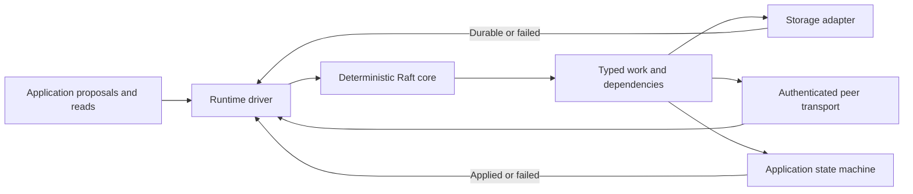

# RFC-0001: A deterministic Go Raft library

**Status:** Draft proposal. No implementation, correctness proof, performance improvement, or platform qualification is claimed.

**Date:** November 1, 2026. **Scope:** An independent, general-purpose Go library implementing Raft, with a reference storage adapter and runtime driver.

## 1. Proposal and decision status

Build a small Raft implementation whose protocol core is deterministic, whose persistence dependencies are explicit, and whose resource consumption is bounded. Retain established Raft safety rules; specialize the library architecture and integration contracts rather than inventing a new consensus algorithm.

The proposed design consists of:

- A single-owner protocol state machine driven by messages, logical time, proposals, and completion events.
- An explicit durability contract for term/vote updates, log replacement, commit progress, and snapshots.
- Separate committed, dispatched, and completed application progress.
- Byte-based admission and replication limits, with bounded snapshot streaming.
- A reference segmented write-ahead log using explicit writes and synchronization. Memory mapping is an optional read optimization.
- Deterministic failure simulation and reproducible benchmarks before making performance claims.

This is a new implementation of the established Raft protocol. Its cost includes maintaining storage recovery, membership transitions, wire formats, compatibility, and adversarial tests.

This repository owns the library, its public contracts, reference adapters, and qualification suite. Its design and release criteria are independent of any consumer. Applications may adopt it through supported Go interfaces; their deployment and migration decisions remain outside this RFC.

## 2. Workload and boundaries

Target applications need an ordered, durable sequence of commands applied consistently across replicas. Examples include replicated key-value stores, metadata services, coordination systems, and control planes. Commands are opaque to the library; consumers decide which operations require consensus. The design prioritizes predictable resource use, explicit durability, and recoverable application state.

Support one voter for embedded use, development, and deployments that accept a single failure domain. It provides neither failover nor replicated-data protection. Three voters require two to commit and can tolerate one voter loss; larger configurations use the same majority rules. Consumers choose membership and failure-domain placement. Scaling application workers or clients does not implicitly change voting membership.

The library owns consensus and the ordering of committed opaque commands. Consumers own command schemas, deterministic application state machines, operation deduplication, and any external effects. Application policy, credentials, and resource ownership stay outside the library. It is not a scheduler, database engine, credential broker, or public gateway.

Assume crash/recovery failures, delayed or duplicated messages, network partitions, and storage failures. Peers are authenticated and trusted to follow the protocol. Byzantine behavior is outside scope. Safety must not require bounded message delay or synchronized wall clocks; progress requires an eventually communicating majority, usable storage, and sufficient execution time.

The replicated log protects the commands and state covered by its durability contract. It does not automatically replicate external files or fence external writers; applications that manage those resources must supply their own guarantees.

## 3. Design rationale

The design makes protocol decisions, durability, and application progress explicit so consumers can reason about failure and resource use through documented contracts.

| Design goal | Proposed mechanism | Intended benefit |
| --- | --- | --- |
| Reproducible protocol behavior | Deterministic core with injected time, randomness, and I/O completions. | Reproduce failures and separate protocol correctness from runtime scheduling. |
| Explicit persistence dependencies | Identify which messages and application actions depend on each durable write batch. | Support safe concurrency while preserving durable quorum requirements. |
| Recoverable hard state | Atomic persistent term/vote state with versioned completion receipts. | Make adapter obligations and crash behavior easier to reason about. |
| Precise application progress | Separate dispatch progress from completed application and expose a wait operation. | Make read and effect-dispatch preconditions precise. |
| Bounded resource consumption | Enforced byte budgets as well as count limits. | Bound memory during bursts, slow application, and follower lag. |
| Honest client outcomes | Structured admission/outcome semantics and application-owned operation identity. | Prevent callers from interpreting a timeout as proof that nothing happened. |

Pre-vote, quorum checks, batching, learners, snapshots, and failure testing form part of the proposed implementation. Replication pipelining and overlapping local persistence with replication require separate ordering tests before enablement. These are established techniques; the proposal concerns their composition and public contracts. Intended benefits remain unmeasured until the acceptance criteria are exercised.

## 4. Protocol

Use leader-based Raft with randomized election timeouts, pre-vote, log matching, the up-to-date voting rule, and majority commitment. A leader advances commitment by counting replicated entries from its current term; commitment of preceding entries follows the Raft rule. Followers advance only through a leader-confirmed matching prefix that is locally durable. Never overwrite committed entries.

Required extensions and choices:

1. **Pre-vote:** Probe election viability before increasing the persistent term. A disconnected member should not unnecessarily disrupt a healthy leader when it reconnects.
2. **Quorum checks:** Step down after insufficient quorum contact for the configured interval. This is a liveness/leadership mechanism, not an external writer fence.
3. **Linearizable reads:** Use a quorum-confirmed read barrier, not clock-based read leases. Establish a current-term committed entry, confirm leadership with a unique read context, and wait for completed application through the resulting safe index before reading a synchronized application view. Batch compatible read barriers.
4. **Membership:** Use joint consensus with explicit joint and final configuration entries. Require separate old/new majorities while joint; persist and recover the transitional configuration. Serialize transitions, add peers as learners, and require authenticated durable catch-up before promotion. No direct assignment of an in-memory voter list.
5. **Leadership transfer:** Defer until the base implementation passes recovery and membership qualification. Ordinary elections are sufficient for the first version.

Read-lease optimizations, multi-group consensus, sharding, multi-region active-active operation, and Byzantine tolerance are outside the first version. The design assumes no wire compatibility with other Raft implementations.

## 5. Library architecture

The core has one mutation owner. It performs no filesystem access, networking, wall-clock reads, or goroutine creation. Timers are logical ticks; election randomness is supplied from a reproducible seed/stream and included in simulation traces. Identical initial state and ordered inputs must yield identical outputs.

Proposed events include `Tick`, `Receive`, `Propose`, `ReadBarrier`, `Persisted`, `StorageFailed`, `Applied`, and snapshot-transfer completions. Proposed outputs include persistence batches, outbound messages with prerequisites, committed entries eligible for application, read results, and status changes. These names describe contracts, not a frozen Go API.

Each asynchronous output carries an epoch and monotonically increasing work ID. Completions must match outstanding work; stale, duplicate, or invalid completions cannot advance state. Payload ownership is explicit: the driver retains immutable bytes until all consumers release them, or copies them under a charged budget. Applications cannot mutate proposed bytes after admission.

The reference driver supplies bounded workers, transport, metrics, and shutdown behavior. Start with one ordered persistence batch in flight per node. Disk, network, and application work may overlap only where dependencies permit. Separate them so slow snapshot/application work does not occupy the protocol event loop. Provide scheduling capacity for control traffic even when proposal admission is saturated.

This follows the deterministic-core approach demonstrated by [etcd Raft](https://github.com/etcd-io/raft); it is an architectural choice, not an originality claim. Ship a usable reference driver so every consumer need not implement safety-critical orchestration themselves.

## 6. Persistence and recovery contract

### 6.1 Durable state

Persist cluster/member/storage identity, format version, current term and vote, the recoverable log, a safe commit watermark, and the authoritative snapshot reference. Membership is reconstructed from the snapshot and appropriate configuration entries, including any joint transition.

Term and vote form one atomic hard-state update. Commit metadata must never reference entries missing from the recoverable log/snapshot. A persisted commit watermark may lag known commitment; entries above it are not assumed committed during recovery. Before handing newly committed entries to the application, durably advance the watermark through the applicable prefix.

An atomic storage batch may contain hard-state changes, a conflicting-suffix replacement, new entries, and commit metadata. Recovery exposes either the previous complete batch or the next complete batch, never a partially applied suffix replacement. Snapshot files may be staged separately, but their authoritative publication must obey the same recoverability rules.

### 6.2 Ordering rules

| Action | Required prerequisite |
| --- | --- |
| Send an affirmative vote | Persist the relevant term and vote. |
| Send a message whose safety relies on a new persistent term | Complete the required hard-state update. |
| Acknowledge follower append success | Persist the matching entries and required term/log changes. |
| Count the leader's local log toward quorum | Complete local persistence through that index. |
| Apply committed entries | Establish commitment and persist the matching local prefix and commit watermark. |
| Return application success | Complete ordered FSM application and retain the result under the application's documented recovery contract. |
| Acknowledge snapshot installation | Durably publish its metadata/data and finish restoring the matching application state. |
| Reclaim log history | Publish a complete recoverable snapshot and retain the history required by configured catch-up policy. |

The first implementation persists before sending dependent replication work. A later optimization may send eligible AppendEntries while the leader's same-batch append runs, after prerequisite hard state and earlier batches are durable. Followers still acknowledge only durable data. Initially require the leader's local copy to be durable before its own application/client completion even when follower acknowledgements form a majority. Test this optimization separately; do not infer permission to reorder all messages.

Storage errors transition the node to a terminal `Failed` state for that runtime instance. Stop proposal admission, voting, success acknowledgements, and newly released application work. Report pending outcomes conservatively. Already transmitted messages and already dispatched external effects cannot be retracted. Recovery requires reopening and validating the store; it is not an automatic empty-state restart.

### 6.3 Reference storage adapter

Use a segmented append-only WAL with versioned records, lengths, checksums, batch boundaries, and sequence numbers. Encode logical truncation/replacement in the recovery protocol so a crash cannot expose an ambiguous combination of old and new suffixes. Persist metadata with the same transactional discipline. Avoid a general-purpose query engine in this adapter.

Use explicit file writes and platform-qualified synchronization. Bound group-commit bytes and delay; all requests in a batch wait for the durability boundary. Include directory durability when creating, renaming, publishing, or deleting files. A successful write call or rename alone is not the durable receipt.

Recovery validates identities, format, sequence, checksums, snapshot consistency, and the committed prefix. Only an incomplete final batch that the format proves disposable may be ignored. Corruption in a committed prefix, a checksum mismatch with uncertain provenance, a missing referenced segment, or an unsupported version requires recovery intervention. Do not silently truncate arbitrary corruption and continue.

Memory mapping is not required. Start with explicit reads and a bounded cache. Consider read-only mapping of immutable sealed segments only after measuring benefit and testing mapping lifetime, reclamation, faults, and the target operating system. Account mapped resident pages and page cache alongside the Go heap. An optional bbolt adapter is also reasonable if it satisfies the same conformance contract; backend choice must not change protocol semantics.

The WAL format, exact synchronization primitives, and on-disk upgrade mechanism require a separate specification before durable implementation is accepted. Designing a log does not establish its crash safety.

### 6.4 Snapshots

Capture an application view at an exact completed index and term. Include effective membership, schema/version information, and application-owned deduplication/ownership state. Require an immutable or consistently isolated view; copying the whole FSM is not the default memory strategy.

Stream snapshots in bounded chunks to staging files with end-to-end integrity checks. Persist and validate the complete snapshot before publishing its authoritative manifest. Then reclaim eligible log segments. Installation must serialize against conflicting FSM application and log changes. Restore failure leaves the node unavailable rather than serving partially restored state.

Snapshot transfer is authenticated, size-limited, and cancellable. Interrupted staging files are never treated as completed snapshots. Resumable transfers are optional later work; the first version may restart a bounded streaming transfer. Snapshot retention cannot exhaust disk indefinitely: stop new writes safely when the storage budget cannot support required recovery assets.

## 7. Application and read API

Expose these separate watermarks:

- `DurableIndex`: the locally recoverable log prefix, accounting for a published snapshot.
- `CommitIndex`: the prefix known committed by Raft.
- `DispatchedIndex`: the prefix handed to the FSM worker.
- `AppliedIndex`: the prefix whose ordered FSM execution has completed.

Within a running incarnation, `AppliedIndex <= DispatchedIndex <= CommitIndex <= DurableIndex` under the conservative delivery policy above. Uncommitted suffix replacement may reduce `DurableIndex`; published snapshots define a floor. Do not treat index values alone as identity across disaster recovery.

Provide `WaitApplied(index)` and a linearizable read operation that combines a safe read barrier with completed application. A bare leadership flag or locally observed commit index is insufficient. Application reads must use a synchronized view at or beyond the barrier index. Follower/stale reads, if added, use a separately named API with explicit consistency semantics.

Provide structured proposal outcomes:

| Outcome | Meaning |
| --- | --- |
| Rejected before admission | This invocation was not admitted; a prior invocation with the same operation identity may still exist. |
| Applied | The committed command completed FSM execution; include index/term and application result. |
| Outcome unknown | Admission occurred or cannot be ruled out, but final application is not known to this caller. |

Context cancellation stops waiting; it does not undo a committed or potentially admitted command. Leadership loss, process failure, or lost replies can produce an unknown outcome. Do not fabricate a durable operation-status service in the consensus library.

Applications requiring retry deduplication store operation ID, request digest, outcome, and retention metadata in their deterministic state machine. Duplicate IDs with equal content return the retained result; mismatched content is rejected. Snapshot/restore preserves these records. Define expiry and backup-rollback semantics before advertising retry safety. Log index alone is not an end-to-end operation ID.

FSM application is deterministic and ordered. Domain rejection is an application result; inability to apply because of local storage failure stops application/proposal success. A persistent FSM must atomically store its mutation, result/deduplication record, and applied watermark. An in-memory FSM reconstructs from its snapshot and committed replay before serving. The consensus core never dispatches cloud or database effects from inside FSM replay.

## 8. Resource and transport contracts

Require finite configurable limits for command bytes, pending proposal count/bytes, uncommitted log growth, append batch bytes/count, per-peer in-flight bytes/messages, decode allocation, snapshot chunks/concurrency, and read waiters. Charge admitted payloads until their references are released. Size and rate limits must apply before attacker-controlled allocation.

Admission returns a typed overload result or waits within the caller's deadline. A lagging follower cannot retain unlimited memory or prevent the healthy majority from progressing. Snapshot catch-up and log retention interact through an explicit policy; neither permits unsafe deletion of committed recovery state. If required storage cannot fit, reject mutations and surface the condition.

Transport uses authenticated member identities bound to cluster identity, bounded framed messages, explicit wire versions, and peer authorization. Authentication does not itself grant voting membership. Reject incompatible formats before protocol participation; address reuse must not imply member identity reuse. Trust/key configuration stays outside the core, and credentials must not enter logs or traces.

Expose queue bytes, durable/commit/applied lag, fsync latency, per-peer progress, election reasons, snapshot progress, storage errors, and overload counts. Metrics cardinality is bounded. Debug traces omit command payloads by default and can be replayed with synthetic or appropriately protected data.

Numeric defaults remain open until measured across representative command sizes, workloads, and deployment resource budgets. A prototype must nevertheless choose and record finite bounds before execution; unspecified limits cannot mean unlimited.

## 9. Bootstrap, membership, and operational recovery

Separate explicit creation, ordinary restart, peer join, and disaster recovery APIs. Creation requires provisioned cluster/member identities, authenticated peer trust, and an explicitly initialized storage identity. Restart requires existing matching state. A missing mount, empty directory, lock failure, or mismatched volume must not trigger bootstrap.

Bind the manifest to an expected externally supplied storage identity; a manifest copied with the wrong volume is not sufficient proof of correct attachment. The runtime supplies qualified exclusive access and platform attachment checks. A local file lock alone is not a distributed ownership fence.

For expansion, admit authenticated learners, verify durable catch-up and resource capacity, and perform one administrative membership transition at a time. A one-to-two voter transition temporarily requires both members; only the healthy three-voter configuration meets the one-failure target. Recovery reconstructs and completes a pending joint transition rather than silently replacing it.

With quorum lost, stop new authoritative mutations. Do not force reconfiguration after an election timeout. Single-member recovery requires its durable volume or an explicitly governed backup restore. Total durable-volume loss is not covered by surviving-volume durability.

Disaster recovery must fence the old cluster authority, establish a new recovery incarnation, and validate backup and storage identity. Consumers must preserve their application recovery metadata and reconcile any external effects newer than the restored state. No automatic live mixed-library migration is proposed. A later migration design must define quiescence, snapshot/schema conversion, external fencing, and rollback custody.

## 10. Consumer integration contract

Consumers implement a deterministic FSM, choose storage and transport adapters that meet the library contracts, configure finite resource limits, and define their application's recovery semantics. The reference driver handles protocol orchestration; it does not impose domain commands or deployment topology.

For applications whose committed state drives external actions, a typical integration is:

1. Commit and apply an operation intent with an application-owned identity.
2. Dispatch the action through an executor with the required authority and fencing.
3. Reconcile uncertain outcomes using the same operation identity.
4. Commit the observed result or unresolved state.

This pattern is optional; a replicated data structure may have no external executor. Where external actions exist, consumers must reconcile unfinished work before conflicting dispatch after leadership changes. A Raft term, commit index, or successful linearizable read does not revoke credentials or stop a previously authorized external writer.

Snapshots must retain the application state needed for recovery. The library guarantees only its documented consensus, persistence, and application-delivery behavior. External execution, resource fencing, and end-to-end retry semantics require consumer-specific validation and are not conditions for unrelated consumers to use the library.

## 11. Verification and comparative acceptance

### Protocol and storage evidence

Build a deterministic simulator with virtual time, seeded elections, scheduled network delivery, and a crashable storage model. Inject dropped, duplicated, delayed, and reordered messages; partitions; pauses; restarts; stale completions; partial writes; failed synchronization; disk-full conditions; and interrupted snapshot publication. Save failing seeds/traces and minimize counterexamples.

Assert election safety, log matching, leader completeness, no divergent committed commands at an index, no loss of acknowledged committed data within the stated surviving-storage failure model, ordered application, and membership safety across joint transitions. Check linearizable operation histories for reads/writes, including lost replies and leader changes. Model pending unsynchronized writes as potentially surviving or disappearing, subject to the specified atomic format.

Combine protocol scenario tests, fuzzing, and deterministic simulation. Simulation, a protocol model, and passing Go tests are not proof of real filesystem durability. Run crash/restart tests against every supported storage adapter and its declared operating-system/filesystem/storage path, including virtualization where applicable.

### Acceptance matrix

| Gate | Required evidence |
| --- | --- |
| Core determinism | Identical initial state, seed, and event trace produce identical outputs; no hidden time or I/O dependencies. |
| Persistence | Boundary-by-boundary crash tests preserve votes, committed prefixes, suffix replacement, and snapshot publication; ambiguous corruption stops recovery. |
| Membership | Crashes and partitions during learner catch-up, joint entry, final entry, and leader removal preserve quorum rules and recoverable configuration. |
| Reads/application | Slow or failed FSM execution cannot produce premature `Applied` success or a stale linearizable read. |
| Client uncertainty | Lost replies/cancellation never imply rollback; a reference FSM demonstrates deduplication with retained operation IDs. |
| Resource bounds | Burst proposals, a stalled FSM, slow peers, oversized frames, and snapshot transfer stay within recorded byte budgets and return bounded overload behavior. |
| Bootstrap/recovery | Missing mount, stale volume, repeated creation, wrong identity, and incompatible formats never create an accidental authoritative cluster. |
| Platform support | Each claimed platform pins Go/runtime, filesystem, storage adapter, transport, and storage path and passes flush, locking, restart, and resource tests. |
| Consumer contract | API documentation distinguishes consensus/application completion from external execution; examples do not imply that leadership fences external resources. |

### Benchmark design

Pin both implementations, storage settings, Go version, hardware/guest, filesystem, payload distribution, and durability semantics. Compare one voter and three voters, steady and bursty command loads, healthy and lagging followers, and snapshot/recovery workloads. Add larger configurations before making scaling claims about them. Use the same application commands and comparable acknowledged-durability guarantees.

Measure resident/peak memory including mappings and kernel cache where observable, allocations, idle CPU, disk bytes/syncs, commit/application p50/p95/p99 latency, sustained throughput, restart time, catch-up time, and overload behavior. Report library overhead separately from the host application and its state-machine footprint.

No numerical win is asserted here. Define supported workload profiles and their resource/latency thresholds before running the comparison. Release acceptance requires meeting those published thresholds and passing correctness/recovery gates. A consumer evaluating replacement must additionally justify its own migration and maintenance costs. Record regressions and uncertainty; a faster happy-path benchmark cannot waive a failed safety gate.

## 12. Alternatives and unresolved choices

| Alternative | Assessment |
| --- | --- |
| Use an existing integrated Raft library with application adapters | May meet a consumer's needs with less implementation and maintenance work. |
| Embed etcd Raft with a small driver/storage adapter | Already supplies a deterministic protocol core and safe-read machinery. Evaluate before implementing a new core; it may satisfy the main goals with less protocol ownership. |
| New Raft core and reference runtime | Gives control over contracts and resource accounting, but creates substantial correctness and maintenance obligations. This RFC specifies that option. |
| Change the consensus algorithm | No workload evidence currently justifies doing so. |
| Require an mmap-backed database | Unnecessary coupling of protocol to storage. Compare adapters under the same durability contract instead. |

Open choices before implementation acceptance: exact Go/module API, WAL/manifest specification, format upgrades, transport encoding, initial supported platforms, numerical budgets, reference adapters for persistent and reconstructed FSMs, and whether a new core offers enough benefit over an etcd-based composition to warrant ownership. Platform-specific targets such as unikernels are optional qualification work, not a prerequisite for the general-purpose library.

A useful first experiment is the deterministic driver and conformance harness around a pinned existing core, plus a bounded one-voter journal on the intended platform. That experiment can invalidate the need for a new core. Three-voter recovery and membership remain library qualification gates; external-effect qualification belongs to consumers that perform such effects.

## 13. Sources and evidence status

- [Raft paper](https://raft.github.io/raft.pdf): protocol, safety, replication, and joint consensus.
- [Ongaro dissertation](https://github.com/ongardie/dissertation/blob/master/stanford.pdf): protocol extensions and implementation considerations.
- [etcd Raft](https://github.com/etcd-io/raft): deterministic core, safe reads, and documented persistence/message ordering. Design reference, not a selected dependency or qualification receipt.
- [bbolt](https://github.com/etcd-io/bbolt) and [SQLite mmap discussion](https://www.sqlite.org/mmap.html): storage alternatives and mapping trade-offs, not platform qualification receipts.

All mechanisms in this document are proposed. Source observations, simulator results, local tests, platform durability, library release acceptance, and consumer deployment acceptance must be reported separately as evidence becomes available.
